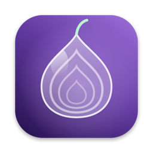
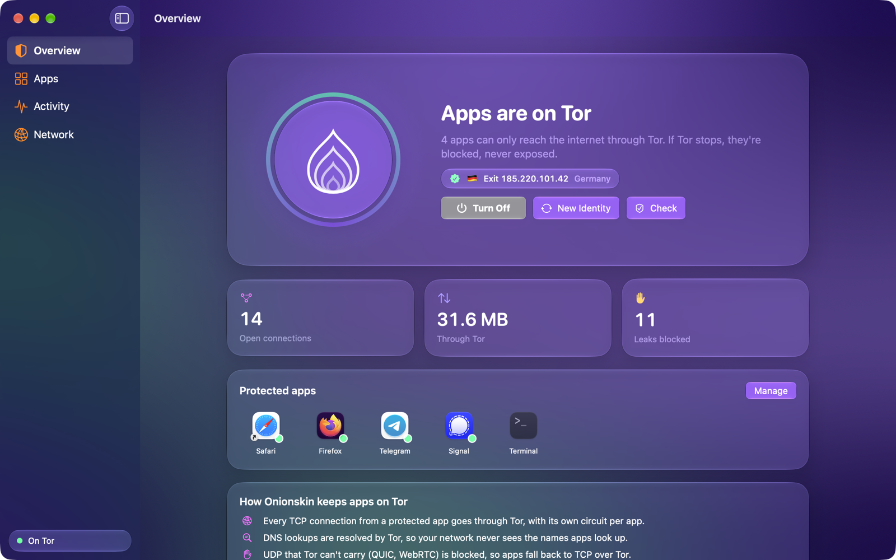
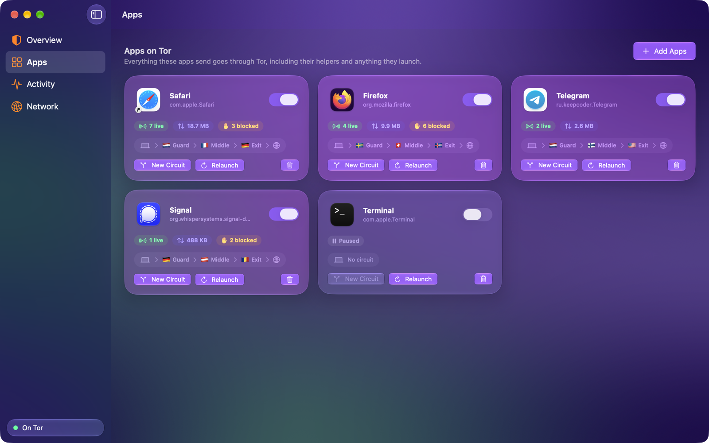
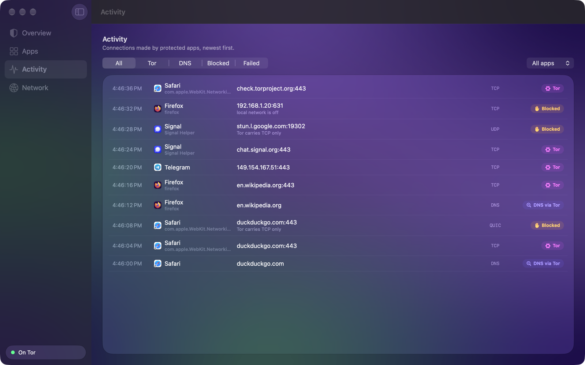
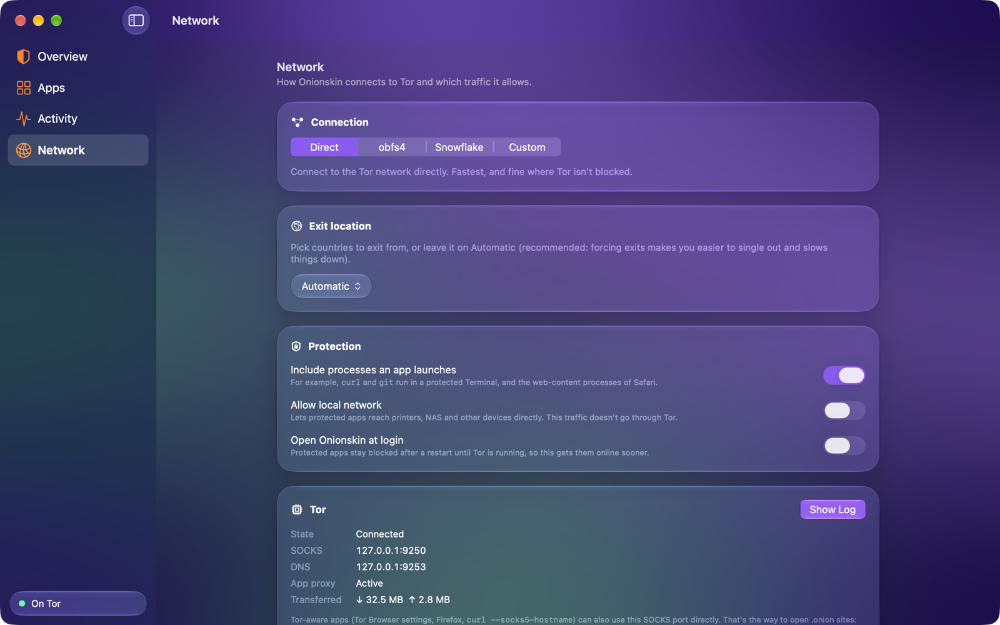

# Onionskin

Send the Mac apps you choose through the Tor network, and only through Tor.

**[Download Onionskin for Mac](https://github.com/perseus-sepahi/onionskin-app/releases/latest/download/Onionskin.dmg)** ·
[All releases](https://github.com/perseus-sepahi/onionskin-app/releases) ·
[Website](https://perseus-sepahi.github.io/software/onionskin/)

## What it does

Pick apps (a browser, a messenger, Terminal) and turn Onionskin on. Everything those apps send
then goes through Tor:

- **Every connection, not just the ones that respect proxy settings.** A macOS network extension
  sees each app's connections, including its helper processes, Safari's and Mail's WebKit
  networking, and tools you run in a protected Terminal.
- **DNS goes through Tor too.** Your network's DNS server never sees the names protected apps
  look up.
- **One circuit per app.** Each app gets its own Tor circuit and exit, so they can't be linked
  to each other by exit address.
- **No leaks around Tor.** UDP that Tor can't carry (QUIC, WebRTC) is blocked, so apps fall back
  to TCP over Tor. Local-network access is off unless you allow it.
- **Kill switch.** If Tor stops, protected apps get no network at all, never your real
  connection. That holds after a restart too, until Onionskin is running again.
- **Works where Tor is blocked**, with built-in obfs4 and Snowflake bridges or your own.
- Apps you don't pick are not affected.

| Apps | Activity | Network |
|---|---|---|
|  |  |  |

The screenshots show sample data.

## Install

1. Download **Onionskin.dmg** and drag Onionskin into **Applications**. It must run from the
   Applications folder, because macOS only allows network extensions from there.
2. Open Onionskin and follow the setup page. macOS asks for two approvals, once:
   - **System Settings → General → Login Items & Extensions → Network Extensions**: turn on
     Onionskin.
   - **"Onionskin" would like to add proxy configurations**: click Allow.
3. Add apps, then click **Turn On**. Relaunch any app that was already running so its existing
   connections close.

Onionskin is signed with a Developer ID and notarized by Apple.

## Requirements

macOS 26 (Tahoe) or later on a Mac with Apple silicon.

## Good to know

- **.onion sites:** macOS refuses to look up `.onion` names for ordinary apps, so a protected
  Safari can't open them. Tor-aware apps can use Onionskin's SOCKS port (`127.0.0.1:9250`, shown
  under Network) with remote DNS, for example `curl --socks5-hostname 127.0.0.1:9250 http://….onion`.
- Onionskin changes how apps connect, not what they reveal. A regular browser on Tor is still
  easier to fingerprint than [Tor Browser](https://www.torproject.org/download/). For the
  strongest anonymity, use Tor Browser.
- To uninstall, choose **Network → Remove Network Extension…**, then delete the app.

## Privacy

Onionskin has no accounts, analytics or tracking, and sends nothing to its developer. See
[PRIVACY.md](PRIVACY.md).

## Reporting bugs

Open an [issue](https://github.com/perseus-sepahi/onionskin-app/issues). Include your macOS
version, the Onionskin version, and the steps that reproduce the problem.

## Source code and licence

Onionskin is free to use but not open source. This repository holds the releases, the issue
tracker and the documentation. See [LICENSE.md](LICENSE.md).

Onionskin bundles Tor, OpenSSL, libevent, libscrypt, obfs4proxy and Snowflake, each under its
own licence; see [THIRD-PARTY-NOTICES.txt](THIRD-PARTY-NOTICES.txt). obfs4proxy is GPLv3, and
its complete source code is attached to every release.

Onionskin is not affiliated with or endorsed by The Tor Project. Tor is a trademark of The Tor
Project, Inc.
